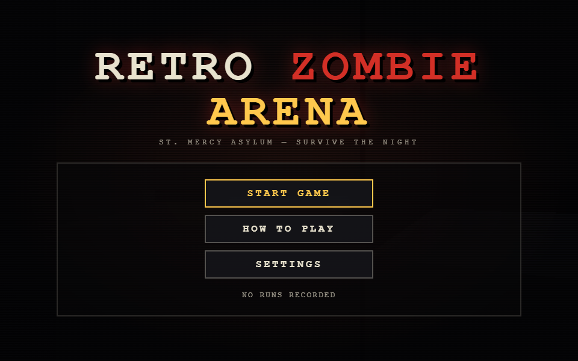
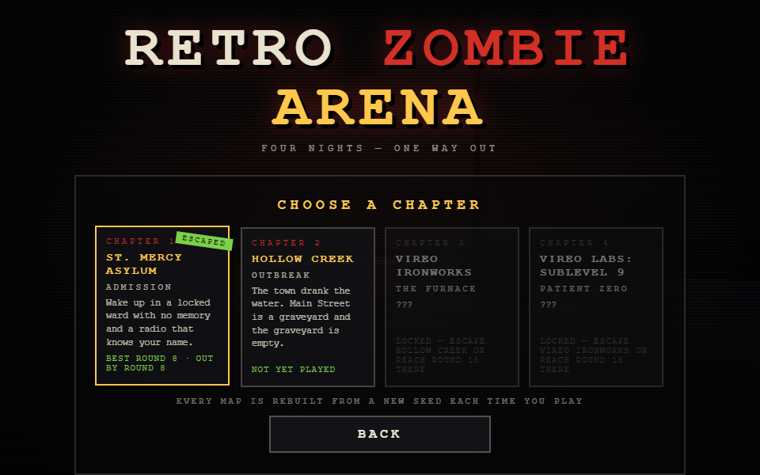
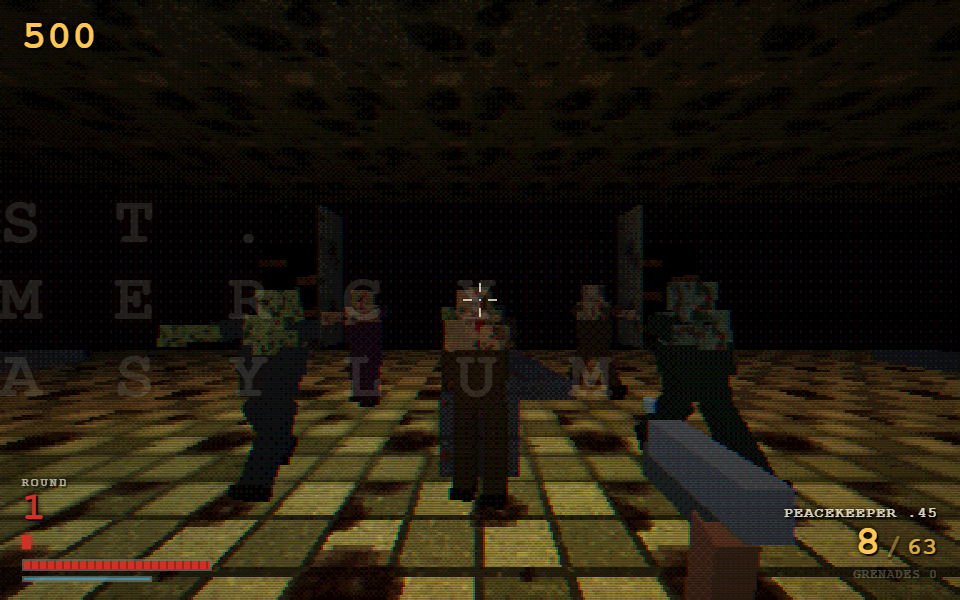
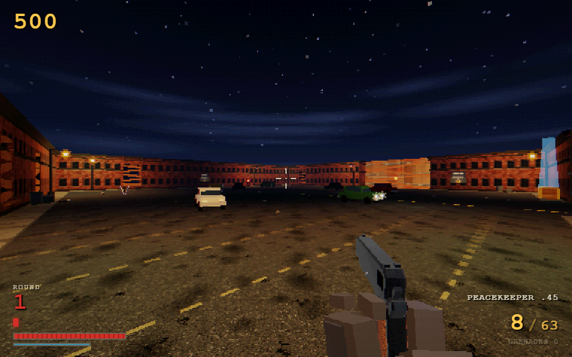
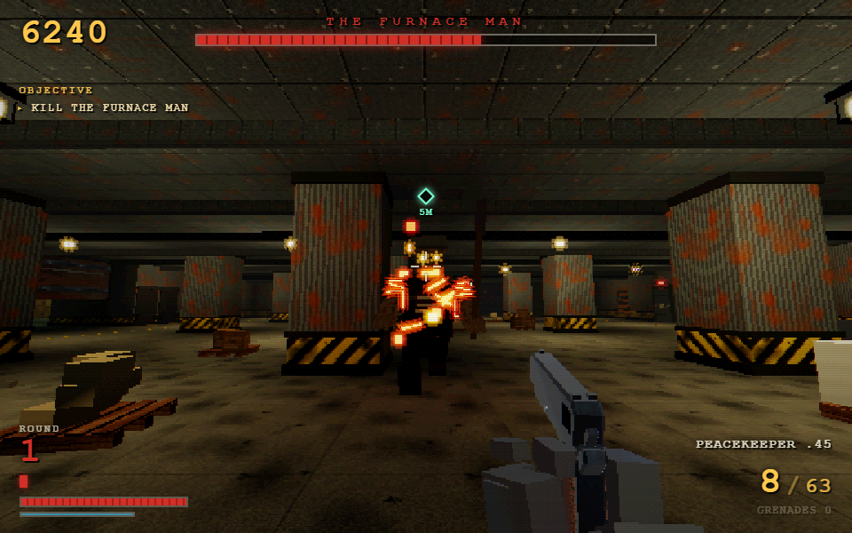

# RETRO ZOMBIE ARENA

An arcade wave-survival FPS that runs in the browser, dressed in the graphics of
the late-90s / early-2000s: a low-resolution HDR framebuffer (360p by default)
point-sampled up to the window, a filmic tone curve, bloom, ordered dithering,
scanlines, chunky nearest-neighbour textures, baked vertex lighting with light
pools and ambient occlusion, and low-poly monsters with glowing eyes.

It borrows its structure from *Call of Duty: Zombies* — points for hits and
kills, doors you buy your way through, wall guns, mystery boxes that roll for a
random (sometimes legendary) gun, perk machines behind a generator, a
Pack-a-Punch you can go back to three times, traps you switch on with points,
power-up drops, boardable windows and an endless round curve — and its feel
from *Doom*: no reload-to-cover, no regenerating cover system, just strafing
backwards through a crowd with a shotgun while the walls close in.

Nothing on the HUD tells you where to go. The objective list says what the job
is; which room it is in is for you to find, and where everything stands changes
every single run.

It also has somewhere to go. Four chapters on four maps tell one story over the
radio, each with a job to do, a boss at the end of it and a way out; escape one
and the next unlocks. Or ignore the story and just survive: the rounds never
stop coming.

**Everything is generated at runtime.** There are no images, models or fonts in
this repository. Textures are painted onto canvases, the guns are modelled in
code from the dimensions of the real firearms they stand in for, lighting is
baked into vertex colours at load, and every sound - down to the zombies' groans,
the player's grunts and the arcade soundtrack - is synthesised with the Web Audio
API. The one exception is speech: words need a real voice, so the announcer and
the player's callouts are short recorded lines (about half a megabyte in all),
baked offline by an open neural text-to-speech model.

| Chapter | Map | The job | The boss |
| --- | --- | --- | --- |
| 1 · Admission | **St. Mercy Asylum** — wards, chapel, catacombs, morgue | find three parts, build Voss a signal booster | The Warden |
| 2 · Outbreak | **Hollow Creek** — open streets under the night sky, the square, the churchyard, houses, the corner shop | build an evac beacon and hold it for a minute | The Butcher (and his dogs) |
| 3 · The Furnace | **Vireo Ironworks** — loading bays, the casting floor, warehouses, the container yard | open the steam valves against the clock, feed the crucible | The Furnace Man |
| 4 · Patient Zero | **Vireo Labs: Sublevel 9** — labs, specimen tanks, server halls, the cryo vault, the reactor | find the keycard, open the vents, hold the purge | Patient Zero |

Every map is regenerated from a fresh seed every time you play it.

| | |
|---|---|
|  |  |
|  |  |
|  |  |
|  |  |
|  |  |

*(Screenshots are captured by `tools/diag.mjs` in headless Chromium with
software WebGL, so they are exactly what the game draws.)*

## Running it

Requires Node 20+ (developed on Node 24).

```bash
npm install
npm run dev        # http://127.0.0.1:5173
```

For a production build:

```bash
npm run build      # type-checks, then bundles to dist/
npm run preview    # serves dist/ at http://127.0.0.1:4173
```

`dist/` is a plain static site with relative asset paths, so it can be dropped
onto GitHub Pages, Netlify, S3 or any static host as-is. It will **not** run
from a `file://` URL — ES modules need a real HTTP origin. Use `npm run preview`
or any static server.

A WebGL-capable browser is required. The game is mouse-and-keyboard only and
uses Pointer Lock, so it needs a desktop browser.

## Controls

| Key | Action |
| --- | --- |
| `W` `A` `S` `D` | Move |
| Mouse | Look |
| Left mouse | Fire |
| Right mouse | Aim down sights |
| `Shift` | Sprint (drains stamina) |
| `Space` | Jump |
| `R` | Reload |
| `F` / `E` | Buy, use, or **hold** to re-board a window |
| `V` | Knife |
| `G` | Grenade (once you have bought some) |
| `1` `2` / `Q` / mouse wheel | Swap weapon |
| `Tab` | Map (centred on you) |
| `M` | Mute |
| `Esc` | Pause (settings are in the pause menu; `Esc` backs out) |

Every key in that table except `Esc` can be rebound under **SETTINGS →
CONTROLS**: click a key, press the one you want. A key already doing another job
is taken off it, so a binding never does two things at once, and an action left
with nothing falls back to its default. Esc stays put because it is the way out
of every screen in the game. Bindings are saved with the rest of the settings,
and the in-game prompts and the HOW TO PLAY list are written from them, so
neither can go stale after a rebind.

## The story

Vireo Pharmaceuticals made Compound L — "Lazarus" — to stop people dying. They
trialled it on the patients of St. Mercy Asylum. It worked, in its way. You wake
up in St. Mercy with three weeks missing from your memory, and a man calling
himself Dr. Voss starts talking to you over the radio. He helped make the stuff,
and he is going to talk you out: through the asylum, the town downstream that
drank its water, the ironworks that was never really an ironworks, and down nine
levels to where the first patient is still waiting.

**PLAY** opens the chapter select. Only the asylum is open at first; a chapter
unlocks when you **escape** the one before it — or survive to **round 15**
there, for players who would rather just hold out. Each chapter has a briefing
and its own job to do, and each asks more of you than the last:

| Chapter | The job | Threat |
| --- | --- | --- |
| 1. St. Mercy Asylum | Restore the power, find the **three parts** on their crates, build the signal booster | Low |
| 2. Hollow Creek | Get the substation running, find the **two parts**, build the evac beacon, then **defend it for a minute** — stay inside its ring while the horde surges at it | Rising |
| 3. Vireo Ironworks | Start the turbines, open all **three steam valves inside 75 seconds** (the clock starts at the first; miss it and they all slam shut), then **feed the crucible** — twenty kills inside its ring | High |
| 4. Vireo Labs: Sublevel 9 | Bring the reactor online, find the **access keycard**, open the **three dispersal vents inside 50 seconds**, then **hold the purge for ninety** | Extreme |

The power is always as far from the start as the map allows, parts sit on
crates under a shaft of light, shut valves under an amber one, and the station
you feed or defend draws a glowing ring on the floor (it never shines through a
wall, and standing on the far side of one does not count). Then every chapter
ends the same way:

- **Survive the boss** the job brings. Fourteen seconds later something comes in
  through a window: a health bar across the top of the screen, a name, and a
  set of moves it telegraphs before it uses them.
- **Escape** through the sealed door in the start room, which opens once the
  boss is dead. That ends the run as a win.

**Threat** is the horde itself getting worse chapter by chapter. Each step makes
zombies a fifth tougher, 5% faster and 10% harder-hitting, sends 12% more of
them a round with more alive at once and quicker spawns, and brings runners and
brutes in a round and a half earlier. The asylum plays exactly as it always
did; by Sublevel 9 a round-three zombie has 60% more health and runners are out
from the first round.

An objective list sits under your points — with the valve clock, the kill
count and the defence timer ticking beside the job in hand, flashing red when
you are running out of time or have wandered out of the ring — and Voss
narrates in subtitles. Nothing points at where to go: the list tells you what
the job is, and the building is yours to learn. Your best round and fastest
escape on each map are saved to `localStorage`.

**The bosses.** Each is built on the zombie rig at nearly twice the size, scales
its health with the round it arrives in, and ignores the nuke and insta-kill.

- **The Warden** slams the floor (jump to clear the shockwave) and charges;
  a charge that hits a wall leaves him **stunned** and taking extra damage.
- **The Butcher** leaps across the room onto you and calls his hellhounds when
  he is hurt.
- **The Furnace Man** throws fireballs that leave the floor burning, cannot be
  set on fire, and starts charging once he is below half health.
- **Patient Zero** spits acid, leaps, slams, calls in runners twice, and in his
  last third he charges, moves faster and winds up quicker.

## How a run works

Each run builds a new layout of the chosen map from a random seed (shown when the
run starts). You wake up in one of its entry rooms with a pistol, 500 points, a
few boarded windows, a shotgun and a submachine gun on the walls, and Quick
Revive in the corner. The maps are big — up to fifteen rooms, many of them
merged great halls, open-air streets and yards, on a footprint of up to 94
tiles square where the original asylum was 56 — so the minimap (`Tab`) follows
you rather than showing the whole thing.

- **Points.** 10 per hit, 60 per kill, 100 for a headshot kill, 130 for a knife
  kill, 10 per board you nail back on, plus a survival bonus at the end of each
  round. (That end-of-round bonus is the one thing the source material does not
  do — it is there to keep the arcade pacing moving.) A kill is multiplied by
  what died: everything in the crowd is worth one, and a **tank** is worth four,
  so 240 for a body shot and 400 for taking its head off.
- **Doors** cost 750–1500, dearer the deeper they lead. Rooms are joined in at
  least one loop, so there is always somewhere to train a horde; on the open
  maps many rooms share a wide archway instead of a door. Zombies only spawn
  from windows in rooms you have opened, favouring the ones near you, so every
  door you buy is also a decision about where they come from.
- **Wall guns** are bought once at full price, then refilled at half.
- **The mystery box** costs 950. The lid opens, guns flick past and slow down,
  and one rises out glowing the colour of its rarity: **common** (45%),
  **rare** (32%), **epic** (18%) or **legendary** (5%) — the Stormcaller
  (chain lightning), Winter's Howl (freezes what it hits) or Dragonfire (a
  flamethrower). Take it within nine seconds. After four to nine pulls a teddy
  bear comes up instead, refunds you and the box flies off to another pad. The
  bigger maps run two boxes at once.
- **The generator** is the one fixture with a rule about where it lands: at
  least two doors in, and further off than anything the start room sells.
  Which of the deep rooms it is changes every run. Until you flip it, the perk
  machines, the traps and Pack-a-Punch are dead metal.
- **Perks** (max four): Quick Revive, Juggernog, Speed Cola, Double Tap,
  Stamin-Up. Only Quick Revive works without power.
- **Pack-a-Punch** works three times on the same gun: tier I (3000), II (5000)
  and III (7000) take its damage to ×2.4, ×3.6 and ×5, grow the magazine and
  reserve, and each paint it in a new glowing camo. Tier II also rolls an
  **ammo mod** — Dead Wire (lightning arcs), Blast Furnace (sets the crowd
  alight) or Cryofreeze (freezes a knot of them) — which tier III fires more
  often. It is not in the generator room any more; it is wherever the layout
  put it.
- **Traps** cost 1000 and every map has two or three: a hazard-striped lever on
  the wall with a pylon either side of it. Throw the switch and the floor
  between the pylons cooks for twenty-six seconds — **electro-shock** locks
  bodies up and fries them where they stand, **flame vents** set them alight and
  they burn on out of the zone. Then the trap has to cool down for twenty-two
  seconds before it will take your money again. The damage is pinned to the
  round's own health curve, so a trap always kills an ordinary body in about a
  third of a second: it is a choke point you can buy, not a weapon that falls
  behind. Kills in it pay you, and it will not hurt you.
- **Power-ups** drop from kills: Max Ammo, Insta-Kill, Double Points, Nuke,
  Carpenter. The announcer calls each one.
- **Hits show.** Anything you hurt gets a small health bar over its head that
  runs green to amber to red, with the chunk you just took off draining away
  behind it, and every hit pops its damage off the body — amber for headshots,
  red for the killing blow, orange for burning. A shotgun blast reads as one
  number.
- **Every fifth round** is a hellhound round: fewer enemies, much faster, and the
  round always ends in max ammo.
- **Nothing is where it was last time.** Pack-a-Punch, the perk machines, the
  wall guns, the mystery box pads, the traps and the quest props each get their
  own shuffle of the rooms. The mystery box can start anywhere on the map, not
  just where you wake up. The only fixtures that stay put are the ones the
  opening depends on: the start room's shotgun, its second gun, Quick Revive
  and the way out.

Enemy health is flat-ish for nine rounds (150 → 950), then compounds at 10% per
round, so eventually nothing you own will kill in one magazine. While a boss is
alive the rest of the horde thins out, so the fight is about the boss.

### What is coming at you

Eight kinds, all built out of the same low-poly body at their own size, tint and
stoop, so a crowd reads at a glance. They phase in as the rounds climb, and
each round mixes them rather than picking one — a chapter's threat brings each
of them forward by a round and a half.

| | From | What it does |
| --- | --- | --- |
| **Shambler** | 1 | The baseline. There are always some. |
| **Crawler** | 3 | Legless, dragging itself along the floor with its head about a metre up. Slow, weak, and easy to shoot over the top of. |
| **Sprinter** | 4 | Lighter and much faster; the one that gets behind you. |
| **Bloater** | 5 | Swollen and yellow. Bursts when it dies — 55 to you at the centre of it, 420 to everything else in seven metres, and it leaves the floor bubbling. A packed room goes off in a chain. |
| **Spitter** | 6 | Sickly green, and it will not close. It holds seventeen metres off and lobs bile that leaves a burning patch where it lands. |
| **Armoured** | 7 | Riot padding and a helmet: body shots do 40%, headshots do the lot. |
| **Brute** | 8 | Head and shoulders over everything else, more than twice the health, hits for 58. |
| **Tank** | 10 | Its own body: half again as tall as a shambler and twice as broad, with slab shoulders, a brace round its neck and plated forearms. Five and a half times the health, body shots do 60%, and it hits for 88. The slowest thing on the map — you can walk away from one; the trouble is that by the time it arrives the rest of the horde has you standing still. Bullets that stagger a shambler barely rock it, it shoulders the crowd out of its way rather than being jostled along by it, and it pays four ordinary kills. Never more than about one body in twenty. |
| **Hellhound** | 5, 10, 15… | Their own round. Fast, low, and they come in packs. |

### Getting around

There is no objective marker and no arrow on the minimap pointing at the
answer. What there is:

- the **objective list**, which says what the job is;
- **light in the world** — the mystery boxes stand under a faint blue beam, the
  quest parts under a green one, perk machines glow once the power is on, and
  trap lamps read green while running and amber while recharging;
- the **minimap** on `Tab`, which draws the building around you and marks the
  powered machines, the boxes, the traps, power-up drops and the horde;
- **door signs**, which name the room on the other side before you pay.

## Graphics settings

Four presets in the settings menu, from **1996** (200p, heavy dither) through
**1999** (240p) and **2003** (360p, the default) to **MODERN** (540p, almost no
post-processing). The 3D scene always renders into a small offscreen buffer and
is point-sampled up to the window, so the pixels stay square no matter how large
your monitor is. **Brightness**, FOV, sensitivity, Y-invert, volume and a
separate **music** volume are also adjustable and persist, and the enemy health
bars and damage numbers can each be switched off.

**Screen shake** and **view sway** each have their own slider. Explosions, boss
slams and the bigger guns all kick the camera, and the walk has a bob on it,
which is a lot of movement for anyone it makes ill. If the browser reports
`prefers-reduced-motion`, both start at zero and can be turned back up.

## Project layout

```
src/
  main.ts              boot, menus, settings, frame loop
  style.css            HUD and menu styling (CRT treatment)
  core/
    retro.ts           HDR render target + tone curve, bloom, dither, scanlines
    input.ts           keyboard + mouse + pointer lock, and the rebindable key map
    audio.ts           procedural Web Audio: guns, voices, foley, HRTF panning, announcer
    music.ts           the arcade chiptune, sequenced and synthesised live
    voice.ts           loads the recorded lines; how often the player speaks
    voicelines.json    every spoken line, and which voice says it
    rng.ts             seeded mulberry32
  gfx/
    textures.ts        every texture, painted onto a canvas at 32–128px
    guns.ts            weapons modelled from real firearms, hands, forearms, camos
    models.ts          zombie/hound models, mesh merging, particle field
    bosses.ts          the four bosses, dressed on the zombie rig
  world/
    maps.ts            the four map profiles: size, openness, kinds of room
    mapdata.ts         the layout generator and the rules every layout must pass
    grid.ts            circle/tile collision, obstacles, DDA rays, flow fields
    themes.ts          what each kind of room (and passage) looks like
    lighting.ts        shadowed light bake, moonlight, light probe
    batch.ts           merges static geometry per material and bakes it
    build.ts           walls, floors, windows, lamps and street lamps
    sky.ts             the night sky over the open-air maps
    furnish.ts         helpers and furniture shared by all set dressing
    dressing.ts        the asylum's rooms, and the dresser for every theme
    dress-town.ts      streets, square, churchyard, houses, shop, garage
    dress-works.ts     loading bays, casting floor, warehouses, container yard
    dress-labs.ts      labs, specimen tanks, servers, cryo, reactor
    props.ts           doors, windows, perk machines, box, traps, Pack-a-Punch
    questprops.ts      the parts, the workbench and the exit
  game/
    rules.ts           round curve, scoring, perks, power-ups (pure)
    weapons.ts         weapons, rarities, Pack-a-Punch tiers, ammo mods (pure)
    player.ts          movement, health, wallet, two-slot inventory (pure)
    enemy.ts           enemy state machine, hit shape, animation, pooling
    horde.ts           the crowd's shared brain: goals, roles, flanking
    boss.ts            boss moves on top of the enemy state machine
    box.ts             the mystery boxes
    elements.ts        lightning bolts, ice and fire effects
    story.ts           the four chapters: briefings, parts, bosses, radio lines
    quest.ts           power -> parts -> build -> boss -> escape (pure)
    progress.ts        unlocks and per-map records (pure rules, localStorage)
    viewmodel.ts       first-person weapon, hands and reload choreography
    hud.ts             DOM HUD: objectives, radio, boss bar, minimap
    tags.ts            health bars and damage numbers over the horde
    game.ts            the loop that ties it together
test/
  logic.test.ts        unit tests over the pure half of the game
  horde.test.ts        pathing round furniture, the roles, tanks, hit boxes
  browser-smoke.mjs    238 checks driving the real game in headless Chromium
tools/
  mapcheck.mjs         prints a generated layout as ASCII, or sweeps many seeds
  hudcost.mjs          times a frame with the HUD painted once a frame vs per step
  diag.mjs             screenshots every room of a seed, the horde and a reload
  story.mjs            screenshots the menus, quest props and every boss
  guns.mjs             contact sheets of every weapon: hip, sights, reload
  deaths.mjs           contact sheet of hit reactions and every kind of death
  lineup.mjs           contact sheet of the kinds side by side, to eyeball a new one
  pursuit.mjs          times how fast a scattered horde finds the player (--round=N)
  voices.py            bakes voicelines.json into public/voice/ (Chatterbox TTS + Whisper)
  voice-refs/          the two synthetic voices the lines are spoken in
public/voice/          the recorded lines, one mp3 per take
docs/                  the screenshots above
```

## How it is put together

A few decisions are worth calling out, because they are what make the look and
the horde possible at the same time:

**Every run is a new layout.** `mapdata.ts` drops rooms into a coarse grid of
cells (up to 4×4 with a few knocked out), merges some neighbours into great
halls, joins the rest with passages along a random spanning tree plus extra
links for loops — some of them wide open archways — themes the rooms, and then
places windows, wall guns, perks, box pads, the power switch, Pack-a-Punch, the
three quest parts, the workbench and the exit against real walls. How big, how
open and what kind of rooms is a per-map profile in `maps.ts`. `validateLayout`
checks every rule the old hand-built map had to pass — props on floor with wall
behind, doors with floor on both faces, the start room sealed until a door is
bought, everything reachable once they all are, clear ground outside every
window, the parts in three different rooms away from the start — and a seed
that fails is re-rolled. `npm run map -- --map=town --sweep 1000` generates a
thousand of them.

**Some of it is outdoors.** Streets, the square, the churchyard, the container
yard and the alleys between them have no ceiling. The walls become building
fronts with a string course and a cornice against the sky; lamps become
cast-iron street lamps standing along the walls and out across the squares;
the bake adds a cold moonlight from the moon's direction to everything open to
the sky; the fog opens right out when you step outside; and a painted night
sky — stars, a band of galaxy, low cloud lit from below, a moon big enough to
bloom — rides along with the camera, drawn first with no depth so the whole
level covers it. Down in Sublevel 9 the windows look into ventilation shafts
instead.

**The level is a handful of meshes, lit once.** `build.ts` walks the tile map
and emits walls in bands - skirting, wainscot, dado rail, upper wall - plus
floors, ceilings, window reveals and lamp fixtures; `dressing.ts` adds each
room's furniture. All of it goes through one batcher that merges it per material
and runs a CPU lighting pass: lamps with a smooth falloff, shadows from a 2D ray
march over the tile grid (so light pools stay in their room and spill only
through doors and windows), baked ambient occlusion in corners and along the
floor, and low-frequency grime to break up texture repetition. At runtime the
scene ambient is set to exactly `π`, which cancels three.js's Lambert `1/π`
term, so a baked colour of 1.0 renders at its full texture value. A per-tile
probe of the same light tints everything that moves, so a zombie under a lamp is
bright and one in the furnace glows orange.

**The picture is colour-correct.** The scene renders linear light into a
half-float buffer; the final pass applies exposure (the brightness slider), a
filmic curve and the sRGB encode *before* it quantises and dithers, so the
colour steps land where the eye can see them. Anything brighter than white -
lamp tubes, zombie eyes, muzzle flashes - blooms.

**Pathing is a flow field, not per-enemy A\*.** A flood fill from a goal tile is
rebuilt about seven times a second over up to ~9000 cells, and every zombie
reads it. Each one thinks a few times a second: with its target in plain sight -
checked with a ray down the middle and one along each shoulder, so it never
tries to squeeze round a corner it cannot fit past - it walks at it; otherwise it
follows the field a few tiles ahead and heads for the farthest point it can walk
straight to, so paths cut corners smoothly. One that has been far away, out of
sight and getting no closer for six seconds is recycled through a window nearer
the player, so the horde never loses the scent. Out of sight and far away, they
also hurry — up to twice their speed across the far side of a big map.

**The field knows about the furniture.** It used to be a plain breadth-first
search over the tiles, which meant a crate or a desk was invisible to it: the
flow pointed straight through a filing cabinet and left a body grinding along the
side of it at full speed, waiting for the collision push-out to shuffle it free.
Now every obstacle feeds a per-tile fill map — how much of each tile the
furniture takes up, sampled on a 4×4 lattice and padded by half a body — and a
full tile costs seven times a clear one to walk through. That makes the rebuild a
small-integer Dijkstra rather than a BFS, which with costs of one, four and seven
is a dial of eight buckets and barely dearer than the queue it replaced. Nothing
is ever made *impassable* by furniture, because a mystery box that lands in a
doorway must never seal a room off; it only ever costs more, so the horde routes
round the furniture and still gets through if going through is the only way.

A body can still end up flat against a desk that only half fills its tile. When
one stops making progress it now picks a neighbouring tile it could genuinely set
off toward — tested against the actual solid boxes, not just the tile map — and
commits to walking there for a second, scoring the candidates so that carrying on
round the same side of the thing beats doubling back. It keeps to that side until
it stops helping and then tries the other, which is what turns a jitter along the
face of a crate into a walk round the end of one.

**The horde works together, and it gets better at it.** `horde.ts` holds four
goals and a field for each: the player, a point out to either side of them, and a
point up the road they are running down, snapped to the nearest tile a body could
actually stand in. Bodies are dealt a role a couple of times a second — come
straight in, swing round the left, swing round the right, or get in front and
stand in the way — and follow that goal's field until they are close enough to
charge. Never more than half the crowd is off manoeuvring: the other half still
walking straight at you is what makes being flanked frightening rather than a
lull, and it is why a lone body never does anything clever at all. The ones already swinging at you are never reassigned; it is the back of
the crowd, which has room to move, that does the manoeuvring, and anything
already manoeuvring keeps its job, because re-dealing from scratch twice a second
leaves a body swinging between two goals and arriving at neither. Bodies that can
see you walk at where you are *going* rather than where you are, and flankers arc
round the outside instead of queueing up behind whoever got there first. One sent
to cut you off will stand in the road for a few seconds and make you come to it.

Two things keep that from becoming a standoff. A manoeuvre that has not reached
its goal in four seconds is abandoned — without that, the pull of a flank goal and
the pull of the player balance out and the crowd hovers in a ring just outside
charging range, which is unnerving and completely harmless. And the few seconds a
body will spend standing in your way is a budget it cannot refill by being dealt
the same job again. How much of any of this is switched on depends on the round:
the first two are the plain straight line the game always had, and it ramps to
the full thing by about the tenth, sooner in a chapter whose threat is already
trying to kill you faster. Only the fields somebody is actually following get
built, and the heavy kinds — tanks, brutes, the armoured, crawlers — never
manoeuvre at all. They are the anvil, far too slow to get in front of anyone, and
walking in a straight line all day is what makes them read as heavy.

`tools/pursuit.mjs --map=town` scatters eighteen zombies over a fully opened map
and times how long they take to find you; `--round=14` does it with the
coordination at full strength, and prints what they spent their time doing. Both
have to end with everybody arriving, because a horde that manoeuvres its way into
never reaching you is worse than a stupid one.

**The story is a small state machine.** `quest.ts` knows only power, three
parts, built, the boss's state and escaped; every transition returns the story
beats it produced, and the game turns those into radio subtitles, banners and
sounds. Because it is pure, the whole chain is unit
tested. **Bosses** are `Enemy` subclasses: they hunt with the same flow field,
but between thinks they pick a move whose cooldown is ready and whose range
fits — a slam up close, a charge or a leap at range, a lob at anything in
sight — stand still for a wind-up pose, then do it. The boss only decides; the
game supplies the consequences through a small hooks interface (shockwaves,
knockback, fireballs and burning ground, summons), so none of it knows about
particles or sound.

**Hits and deaths have weight.** A hit rocks the body away from the shot on a
spring, snaps the head back on a headshot, staggers it for a moment and shoves
it back. A kill picks a death - thrown on its back, pitched onto its face,
buckling at the knees and keeling over, or launched and tumbling by an
explosion - and a headshot kill takes the head clean off. Bodies stay down for a
couple of seconds before they sink through the floor. How hard a hit rocks a body
scales down with its size, so the magazine that staggers a shambler barely moves
a tank. `tools/deaths.mjs` renders a contact sheet of all of it.

**You can shoot a body where you can see it.** A body is a cylinder capped at the
ankles and the crown of the head, lying along its *spine* rather than standing
vertically at its feet — which for anything upright is the same thing, and for a
crawler is the difference between working and not. A crawler is the ordinary body
pitched over a radian onto its front, and the model pivots at the floor, so the
head it draws ends up better than a metre in front of the point it stands on.
Against a vertical cylinder at its feet, shooting the head you could plainly see
did nothing at all, while shooting the empty floor behind it scored a headshot.
The draw position now steps back half that reach as well, so a stooped body
straddles the point it navigates by instead of trailing behind its own head —
which also means a crawler's swing lands when it looks like it should, rather
than after it has walked through you. Which end of the body a shot counts as goes
by where the ray runs closest to the spine, not where it crosses the surface: a
body lying nearly along the line of fire is entered at the flank and left through
the head, and what the crosshair was over is the head.

**The guns are modelled, not imported.** `guns.ts` builds each weapon in
metres from its real-world reference - M1911, Thompson M1928 with the drum, M3
Grease Gun, AK-47, scoped Lee-Enfield No.4, SPAS-12, a sawed-off coach gun, an
M9 bazooka - out of extruded side profiles, cylinders and boxes, with named
anchors for the hands, magazine, bolt, pump and muzzle. The first-person weapon
renders in its own scene after a depth clear (the standard trick for keeping a
long barrel out of walls), with reflections from a generated environment map.
Aiming down the sights is computed from each gun's actual sight line.

**Reloads are choreographed.** The right hand is fixed to the grip; the left is
driven by keyframed timelines per reload style: pull the magazine, fetch a new
one, seat it, rack the charging handle; drop a pistol mag and release the slide;
break the shotgun and thumb in two shells; feed a pump gun one shell at a time;
work a bolt and push down a stripper clip. Timelines are normalised to the real
reload time, so Speed Cola speeds up the whole performance, and every step cues
its own synthesised foley.

**The dead have voices.** Each groan is a sawtooth glottal source with a sagging
pitch contour and a vocal-fry rattle, soft-clipped, then passed through three
formant filters that glide between vowels ("oooaaahhh") and into a generated
reverb. Walkers moan, hunters growl, attackers snarl, runners scream and the
dying gurgle; brutes are pitched down. A voice limiter keeps a full horde from
turning into mush. The player's grunts come out of the same throat tuned human,
rougher the harder the hit and the lower your health, with a death cry at the
end.

**You can hear where they are.** Every sound in the world plays through a
head-related (HRTF) panner, and the listener's ears move with the camera every
frame, so a moan that starts on your left swings to your right as you turn and a
zombie behind you sounds behind you. Distance is a gain curve plus a wetter
reverb mix the further off a sound is.

**The announcer calls the drops, and you talk back.** Picking up a power-up
plays a low boom, ducks the music and has a huge voice call it — "Max Ammo!",
"Insta-Kill!", "Double Points!", "Kaboom!", "Carpenter!" — and he announces
the hellhounds and the game over too. The player has his own lines: reloading,
running dry, throwing a grenade, a round starting and ending, a headshot, three
at once with an explosive, a legendary gun or a teddy bear out of the box, a
perk, Pack-a-Punch, the boss arriving and going down, being close to death, a
job done, holding the line at the station and the valves slamming shut.
They are paced so he is not a chatterbox: each moment has a chance of a line
and a cooldown, he leaves a few seconds between lines, never talks over the
announcer, and only the big moments cut him off mid-sentence.

The lines are recorded ahead of time rather than read out by the browser.
`tools/voices.py` runs [Chatterbox](https://github.com/resemble-ai/chatterbox)
(MIT), an open neural text-to-speech model with a dial for how much emotion
goes into a line, locally on the GPU over `src/core/voicelines.json`, and writes
one small mp3 per take to `public/voice/`. The two voices come from short
reference clips in `tools/voice-refs/` that were themselves spoken by
[Kokoro](https://github.com/hexgrad/kokoro), so no real person's voice is
cloned. A hot take can mumble or add a word, so every line is generated six or
more times; each take is transcribed with Whisper and dropped unless it says
the line, and of the rest the liveliest is kept — the one whose pitch moves the
most, measured with Praat, short of cracking or squawking. At runtime each
player line plays a hair higher or lower than the last time, and the announcer
is slowed like an old sampler, doubled by a second copy a hair slower still,
warmed through a soft clipper and sent heavily into the reverb.

To change a line, edit the JSON and rebake it (`--only player.teddy`), or
everything with `--force`. The setup is in the script's header: Python 3.11, an
NVIDIA GPU and about 6 GB of downloads, all kept in `tools/.voicegen/`.

**The soundtrack is an arcade chiptune.** `music.ts` sequences it live on the
audio clock, on four channels the way the sound chips of the era had them: a
pulse-wave lead with a scoop, vibrato and a dotted-eighth echo, a bouncing
triangle bass, a thin fast arpeggio and a noise-and-sine drum kit. It is in A
minor with the E major chord that gives old horror platformers their menace,
and runs through seven four-bar sections. It follows the game: the round and the
size of the horde push it from 126 to 160 BPM and bring the drums from a light
pulse to flat out; between rounds it drops to a breakdown, and the next round
kicks in at the top of the tune with a crash. Changes wait for the bar line.

**Nothing allocates in the hot path.** Enemies, tracers, decals, particles,
casings and power-up drops are all pooled and built once in the constructor.
Each zombie's static boxes are merged per joint, so a body costs under twenty
draw calls however much detail it carries.

**The simulation and the picture run on different clocks.** The world steps at a
fixed 120 Hz, up to eight steps a frame, so the physics and the horde behave the
same however fast the machine is. Presentation - the HUD, the bars and numbers
over the horde and the minimap - is DOM and canvas work
whose only consumer is the screen, so the frame loop paints it once per drawn
frame instead. Doing it per step painted it two to four times over, and because
the tags measure the window after writing eighty inline styles, each repeat cost
a forced layout; worse, the cost grew with the number of steps a frame took, so
a frame that was already late did the most redundant work. `Game.present()` owns
that pass, and `npm run hudcost` measures what it is worth.

**Damage tells you where it came from.** Being surrounded is the whole game, so
a hit puts a wedge on the ring around the crosshair at the bearing of whatever
landed it - straight up is dead ahead, so a bite from behind lands under your
feet, where you look for it. Swings, shockwaves and thrown things all carry a
position; your own grenade and burning ground you are standing in have no
direction worth pointing at, and get the red vignette on its own.

## Verification

```bash
npm run typecheck     # tsc --noEmit, strict, erasableSyntaxOnly
npm test              # 96 unit tests (node:test, runs .ts directly)
npm run map           # prints a random asylum and validates it
npm run map -- --map=labs --sweep 1000   # generates and validates a thousand seeds
npm run build         # type-check + bundle
npm run test:browser  # builds, then runs 238 checks in real headless Chromium
npm run hudcost       # what the HUD costs per frame, painted once a frame vs per step
```

`npm test` covers the pure half: that 300 generated asylums, and sixty of
every other map, each pass every layout rule (sealed until a door is bought, fully connected after, every window,
wall gun, perk machine and pad on legal geometry, clear ground outside every
window), that a seed always rebuilds the same asylum and different seeds do
not, that door prices climb with depth, that collision ejects a body out of a
wall rather than through it, that the flow field strictly descends to its goal
from every reachable tile, that every weapon has a model, that the round
curve never gets easier, that the box's rarity odds hold, that each
Pack-a-Punch tier hits harder, that every chapter's chain of jobs runs in
order (no building without power, no vents without the keycard, a defence that
only counts in the ring, valves that all slam shut when the clock runs out, no
escaping with the boss alive), that no two chapters ask for the same jobs and
each asks more than the last, that every chapter's horde is tougher, faster,
bigger and meaner than the one before without ever running the enemy pool dry,
that the valve spots stay out of the start room, that escaping or reaching
round 15 unlocks the next map and nothing else, that every chapter has a
boss and something to say at every beat its jobs produce, and that bosses get
tougher chapter by chapter and round by round. It also covers the two things
read back off disk: that every action has a default key, that no key does two
jobs out of the box and that the game will not hand over the ones it or the
browser needs; and that saved progress survives being nonsense - a record with
a string where a round should be, an escape time with no escape behind it, a
map that no longer exists - rather than putting NaN onto the chapter cards.

`horde.test.ts` covers the parts of the horde that are maths rather than feel.
For the pathing: that a tile packed with furniture reads as near solid and its
neighbours do not, that you can see over a crate but not walk through one, that
the flow field walks a body *round* a crate rather than over the tile it sits on,
that a crate filling a one-tile corridor makes the way through dearer without
ever making it impassable, that the field still descends strictly to its goal
from every tile once costs are involved, that each slot holds its own field
without disturbing the others, and that a goal asked for inside a wall gets
nudged out to somewhere a body could actually stand — preferring a clear tile to
one full of furniture, and giving up rather than inventing floor in the void.
For the crowd: that coordination is nil for the first two rounds, climbs, tops
out by the tenth, never dips, and arrives sooner under threat, and that the heavy
kinds are left out of it. For tanks: that one is bigger, tougher, slower and
harder-hitting than everything else, that it pays exactly four ordinary kills
while nothing else got quietly repriced, that it cannot turn up before round ten
and never makes up more than 6% of a round, and that every kind of enemy has a
pooled body to be built from.

The hit-box tests pose a body by hand and then work out where three.js will draw
it, from the same root transform the animation sets — deliberately without going
near the enemy's own head getters, because the invariant worth testing is that
what is drawn and what is shot are the same thing. So: that an upright body is
drawn exactly where it stands and tells a headshot from a chest shot and a miss;
that a crawler's head agrees with the drawn head at five different facings, sits
about half a metre off the floor, and is far enough in front of its feet to have
been outside the old hit box entirely; that a shot at where its head is drawn
scores a headshot while one at its hips does not; that a shot straight up through
the air over its feet — which used to be a headshot — now misses; that from the
side it is only a body wide; and that a tank is taller, broader, heavier, can be
shot in the head up where a shambler has none, and shoves a shambler aside
instead of being jostled along by it, while two bodies of a size still share a
shove down the middle as they always did.

`npm run test:browser` is the one that matters for "does it actually work". It
builds, serves `dist/`, opens it in headless Chromium with software WebGL, and
drives the real game object. Two of its sections are there specifically to hold
the line on the two riskiest things in the game: that solid furniture has not
sealed anything off, and that every kind of zombie does its own thing. The
first walks all four maps on a one-unit lattice, using the real collision code
as the test for whether the player's own body fits — about two hundred thousand
cells — with every door open, and fails if a single machine, pad, trap or quest
prop has been walled in. The second spawns one of each kind and checks that a
brute is bigger than a shambler, that a crawler's head is near the floor, that
armour blunts a body shot and not a headshot, that a bloater's death hurts the
body standing next to it and that a spitter throws instead of closing. A third
section holds the line on the horde actually being relentless: it opens every
door, scatters twelve zombies across the whole map and fails unless every last
one of them reaches the player, which is the check that catches an AI clever
enough to talk itself out of attacking. It reads the low-resolution framebuffer back and
asserts the world rasterised with a real tonal range; runs 45 seconds of round 1
and checks that enemies spawn, tear boards off windows, get inside and hurt an
idle player; buys a door and confirms the tile became walkable; buys a wall gun,
a perk, Pack-a-Punch and a mystery box pull; applies power-ups; holds the
trigger down on a line of zombies and checks that ammo drains, points accrue,
headshots register, reloads refill, an empty gun stays empty, a wall stops a
bullet and the same burst lands in the open; clears a round and checks the
counter advanced; pauses and resumes; kills the player and checks the run
reports stats; starts six runs and checks each got a different asylum, that a
seed replays and that rebuilding the world does not leak GPU memory; reloads
every weapon from empty and checks the animation finishes, refills the gun and
cues its foley; aims the scoped rifle; opens settings from the pause menu,
changes one live and backs out with Esc; scatters a dozen zombies over an open
asylum and checks every one finds the player; checks a hit rocks and shoves a
body and a kill drops it, leaves it on the floor, then cleans it up; sounds
every kind of zombie voice through a real AudioContext and floods the voice
limiter; listens to each ear to check a sound on the right is heard on the
right, and that turning round re-pans one already playing; checks the player
grunts when hit; loads every recorded voice line, checks the announcer calls a
power-up through the mix and the player keeps to one line at a time; checks the
music starts in its breakdown, kicks into the tune on a round, has a beat,
speeds up with the horde and stops; hurts a zombie and checks its health bar,
its damage numbers (one for a shotgun blast, a headshot, a kill) and the
settings that hide them; builds all four maps and checks their boxes, sky and
their chapter's props; builds the town's beacon and checks the defence only
counts inside the ring while the horde surges past the round's count, opens a
steam valve in the ironworks and lets the clock run out, feeds the crucible a
kill inside its ring and one outside it, checks Sublevel 9's vents stay locked
without the keycard and that its round three is tougher than the asylum's;
plays the whole
story on the asylum — objectives and radio, power, the three parts,
the build, the boss arriving through a window with its health bar, surviving
a nuke, dying, the exit opening, the victory screen and the next chapter
unlocking; sets each of the four bosses on an idle player and checks it
arrives, uses its moves and hurts; walks the chapter select, a locked
chapter and a briefing; hits the player from each of the four quarters and from
a turned-around stance and checks the damage wedge points the right way, and
that damage with no direction shows none; drives the rebinding panel the way a
player would — click the row, press the key — and checks the key comes off
whatever else had it, that Esc cancels the rebind instead of closing the screen,
that the HOW TO PLAY list follows along, that the binding is saved and that a
reset clears it; and turns the screen shake down and checks the camera holds
still, then feeds the settings loader a stored file full of nonsense and checks
nothing infinite reaches the camera — then asserts no console or page errors
throughout.

It needs Chromium once: `npx playwright install chromium`.

`npm run hudcost` measures what the HUD costs per frame. Presentation is DOM and
canvas work and the frame loop paints it once per drawn frame, not once per
simulation step; this stands a crowd around the player with the minimap open and
times a frame both ways. The saving is a fraction of a millisecond, so it times
the two arrangements in short alternating trials and takes the median of each -
timing one and then the other picks up drift several times larger than the
difference. Under software WebGL at round 9 with twenty zombies up it reports no
difference at one step a frame (the same work either way), about 0.14 ms at two,
and about 0.43 ms at four, where the redundant painting was more than doubling
the cost of the frame. That shape is the point: a frame only takes four steps
when it is already behind.

`tools/diag.mjs [seed] [--map=town]` writes screenshots to `tools/shots/<map>/`
- one per room of that seed's layout, a window, the horde, hounds and a
reload - along with brightness statistics of the finished frame.
`tools/story.mjs` shoots the chapter select, a briefing, the quest props and
each boss up close. It is how the lighting was tuned,
and it is the fastest way to see whether a rendering change made things better
or worse. `tools/guns.mjs [weapon...]` renders a contact sheet per weapon: hip,
aiming down the sights, and four moments of its reload.

## Assumptions made

This was built from a one-line brief, so a few things were decided rather than
asked:

- **Web / TypeScript / three.js**, because "runs anywhere by opening a link" is
  worth more for a game like this than native performance, and because it makes
  the whole thing verifiable headlessly.
- **Single player only.** Co-op is the other half of the source material, but it
  needs netcode, and the brief said arcade.
- **The story is original.** Vireo, Compound L, Dr. Voss and the four bosses are
  made up for this game; the structure (build something, fight what it
  summons, get out) is the genre's.
- **Escaping ends the run.** It is a win screen with your stats rather than an
  option to carry on; the endless mode is simply not escaping.
- **Unlocks have a second door.** Surviving to round 15 on a map also opens the
  next one, so a player who never wants to do the objective is not locked out.
- **Downs are final.** There is no bleed-out-and-self-revive; a down ends the
  run. Quick Revive instead speeds up health regeneration.
- **A survival bonus at the end of each round**, which the source material does
  not have, to keep early rounds from dragging.
- **Furniture is solid, clutter is not.** The nav grid has an obstacle layer
  under the tiles, and everything with real bulk goes in it: the machines, the
  mystery boxes (which move), the trap pylons, the workbench, and any piece of
  set dressing with a chunky box at body height. `pieceAt` works that out from
  the geometry a piece emits rather than making every dresser declare it, which
  is why all four maps got it at once. Loose paper, rubble, drip stands and
  privacy screens stay walk-through, no single box is allowed to be wider than
  a tile, and each one is pulled in 8% so a body brushes past rather than
  snagging — the arena keeps its clean lines, but the horde no longer strolls
  through a vending machine.
- **Obstacles cost the pathfinding, they do not block it.** The flow field is
  still tile-based — there is no sub-tile navigation mesh, which would cost far
  more than it is worth here — but each tile now carries how much of it the
  furniture fills, and a full one costs seven times a clear one to cross. So the
  horde routes round the furniture rather than into the side of it, and a body
  that gets wedged anyway follows the thing round. Nothing is ever made
  impassable by furniture: a mystery box that packs up and lands in a doorway
  must not seal a room off, so going through stays possible, just expensive.
  Bullets ignore obstacles entirely — you can shoot a zombie through a crate,
  which is the arcade answer and the one the rest of the game already gave, and
  a body can see you over one even where it cannot walk through it.
- **No objective marker.** The one on the HUD used to name the exact spot and
  the distance to it, which made every map the same map. Finding the room is
  the game now; the props light themselves, and the minimap draws what you have
  turned on rather than where you should be going.
- **Traps do not hurt the player.** In the source material the electric trap
  will kill you too. With nothing marking where the traps are, and their
  position rolled fresh every run, walking into one you had not found yet would
  be a death with no lesson in it.
- **Almost everything is placed at random**, including Pack-a-Punch and the
  first mystery box, which can now be behind any door on the map. Only the
  generator has a floor on how deep it is, and only the start room keeps a
  fixed loadout, so the opening thirty seconds of a run are always playable.
- **No gore beyond blood particles and decals** — bodies crumple and sink rather
  than dismembering, other than the gib-on-overkill case.
- **Weapons are modelled from references, not downloaded.** Third-party gun
  models come with licences and attribution strings, and this project ships no
  asset files, so each gun is built in code from the published dimensions and
  silhouette of the real firearm. The two wonder weapons are homages, not copies.
- **Old settings move to the new renderer.** Settings saved before the
  colour-correct renderer keep sensitivity, volume, FOV and Y-invert, but start
  on the new default graphics preset, since the old default was tuned for a
  picture that was far too dark.
- **Esc is not rebindable.** It is the way out of every screen in the game, and
  the browser gives it up out of pointer lock anyway, so handing it to another
  action would leave a player with no way back to the menu.
- **A rebind replaces every key for that action**, rather than editing a primary
  and an alternate separately. It costs the arrow keys and the second shift if
  you rebind movement or sprint, but one click and one keypress is the whole
  interaction, and RESET TO DEFAULTS brings the alternates back.
- **A lost WebGL context asks for a reload** rather than rebuilding itself. Every
  texture, mesh and baked light is generated at load, so there is nothing cached
  to re-upload; restoring it would mean re-running the whole build, which is
  most of the loading time, for a case that should not happen.

## Licence

No licence chosen; the brief did not specify one. All assets are generated by
the code in this repository, so there is nothing third-party to attribute beyond
[three.js](https://threejs.org/) (MIT).
