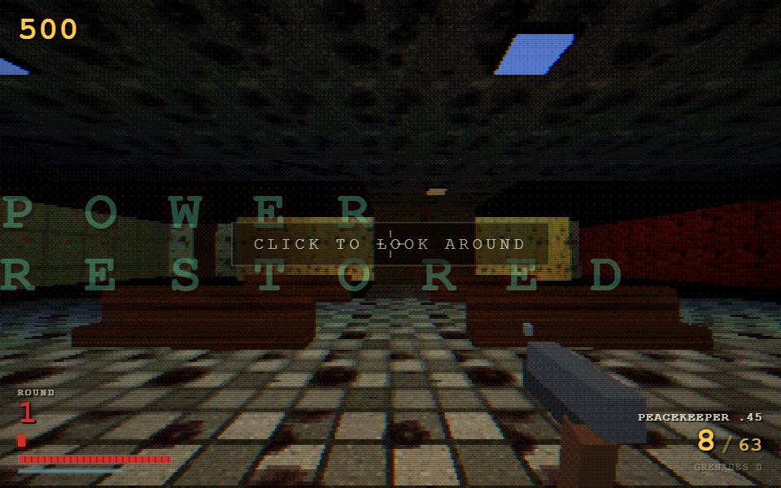

# RETRO ZOMBIE ARENA

An arcade wave-survival FPS that runs in the browser, dressed in the graphics of
the late-90s / early-2000s: a low-resolution HDR framebuffer (360p by default)
point-sampled up to the window, a filmic tone curve, bloom, ordered dithering,
scanlines, chunky nearest-neighbour textures, baked vertex lighting with light
pools and ambient occlusion, and low-poly monsters with glowing eyes.

It borrows its structure from *Call of Duty: Zombies* — points for hits and
kills, doors you buy your way through, wall guns, a roaming mystery box, perk
machines behind a generator, Pack-a-Punch, power-up drops, boardable windows and
an endless round curve — and its feel from *Doom*: no reload-to-cover, no
regenerating cover system, just strafing backwards through a crowd with a
shotgun while the walls close in.

**Everything is generated at runtime.** There are no images, models, fonts or
audio files in this repository. Textures are painted onto canvases, the guns are
modelled in code from the dimensions of the real firearms they stand in for,
lighting is baked into vertex colours at load, and every sound - down to the
zombies' groans - is synthesised with the Web Audio API.

> **ST. MERCY ASYLUM** — a different building every night: six to eight rooms,
> the doors between them, and one way out: there isn't one.

| | |
|---|---|
|  |  |
|  |  |

*(Screenshots are captured by `tools/diag.mjs` in headless Chromium with
software WebGL, so they are exactly what the game draws.)*

## Running it

Requires Node 20+ (developed on Node 24).

```bash
npm install
npm run dev        # http://127.0.0.1:5173
```

For a production build:

```bash
npm run build      # type-checks, then bundles to dist/
npm run preview    # serves dist/ at http://127.0.0.1:4173
```

`dist/` is a plain static site with relative asset paths, so it can be dropped
onto GitHub Pages, Netlify, S3 or any static host as-is. It will **not** run
from a `file://` URL — ES modules need a real HTTP origin. Use `npm run preview`
or any static server.

A WebGL-capable browser is required. The game is mouse-and-keyboard only and
uses Pointer Lock, so it needs a desktop browser.

## Controls

| Key | Action |
| --- | --- |
| `W` `A` `S` `D` | Move |
| Mouse | Look |
| Left mouse | Fire |
| Right mouse | Aim down sights |
| `Shift` | Sprint (drains stamina) |
| `Space` | Jump |
| `R` | Reload |
| `F` / `E` | Buy, use, or **hold** to re-board a window |
| `V` | Knife |
| `G` | Grenade (once you have bought some) |
| `1` `2` / `Q` / mouse wheel | Swap weapon |
| `Tab` | Map |
| `M` | Mute |
| `Esc` | Pause (settings are in the pause menu; `Esc` backs out) |

## How a run works

Every run generates a new asylum from a random seed (shown when the run starts
and on the pause screen). You wake up in one of its entry rooms - admissions, a
ward or the records office - with a pistol, 500 points, a few boarded windows, a
shotgun and a submachine gun on the walls, and Quick Revive in the corner.

- **Points.** 10 per hit, 60 per kill, 100 for a headshot kill, 130 for a knife
  kill, 10 per board you nail back on, plus a survival bonus at the end of each
  round. (That end-of-round bonus is the one thing the source material does not
  do — it is there to keep the arcade pacing moving.)
- **Doors** cost 750–1500, dearer the deeper they lead. Rooms are joined in at
  least one loop, so there is always somewhere to train a horde; now and then
  two rooms share an open archway instead of a door. Zombies only spawn from
  windows in rooms you have opened, so every door you buy is also a decision
  about where they come from.
- **Wall guns** are bought once at full price, then refilled at half.
- **The mystery box** costs 950, gives you a random weapon from a weighted pool,
  and packs up and moves somewhere else after four to nine pulls.
- **The generator** is always the room farthest from where you start. Until you
  flip it, the perk machines and Pack-a-Punch are dead metal.
- **Perks** (max four): Quick Revive, Juggernog, Speed Cola, Double Tap,
  Stamin-Up. Only Quick Revive works without power.
- **Pack-a-Punch** costs 5000, roughly doubles a weapon's damage and paints it
  in a glowing camo.
- **Power-ups** drop from kills: Max Ammo, Insta-Kill, Double Points, Nuke,
  Carpenter.
- **Every fifth round** is a hellhound round: fewer enemies, much faster, and the
  round always ends in max ammo.

Enemy health is flat-ish for nine rounds (150 → 950), then compounds at 10% per
round, so eventually nothing you own will kill in one magazine. Runners appear
from round 4, brutes from round 8. Your best round is saved to `localStorage`.

## Graphics settings

Four presets in the settings menu, from **1996** (200p, heavy dither) through
**1999** (240p) and **2003** (360p, the default) to **MODERN** (540p, almost no
post-processing). The 3D scene always renders into a small offscreen buffer and
is point-sampled up to the window, so the pixels stay square no matter how large
your monitor is. **Brightness**, FOV, sensitivity, Y-invert and volume are also
adjustable and persist.

## Project layout

```
src/
  main.ts              boot, menus, settings, frame loop
  style.css            HUD and menu styling (CRT treatment)
  core/
    retro.ts           HDR render target + tone curve, bloom, dither, scanlines
    input.ts           keyboard + mouse + pointer lock
    audio.ts           procedural Web Audio: guns, zombie voices, reload foley, reverb
    rng.ts             seeded mulberry32
  gfx/
    textures.ts        every texture, painted onto a canvas at 32–128px
    guns.ts            weapons modelled from real firearms, hands and forearms
    models.ts          zombie/hound models, mesh merging, particle field
  world/
    mapdata.ts         the asylum generator and the rules every layout must pass
    grid.ts            circle/tile collision, DDA raycasting, BFS flow field
    themes.ts          what each kind of room looks like
    lighting.ts        lamp placement, shadowed light bake, light probe
    batch.ts           merges static geometry per material and bakes it
    build.ts           walls, floors, windows, lamps: the layout as geometry
    dressing.ts        per-room set dressing: pews, beds, boilers, coffins...
    props.ts           doors, windows, perk machines, box, Pack-a-Punch
  game/
    rules.ts           round curve, scoring, perks, power-ups (pure)
    weapons.ts         the weapon table (pure)
    player.ts          movement, health, wallet, two-slot inventory (pure)
    enemy.ts           enemy state machine, animation, pooling
    viewmodel.ts       first-person weapon, hands and reload choreography
    hud.ts             DOM HUD and minimap
    game.ts            the loop that ties it together
test/
  logic.test.ts        32 unit tests over the pure half of the game
  browser-smoke.mjs    82 checks driving the real game in headless Chromium
tools/
  mapcheck.mjs         prints a generated asylum as ASCII, or sweeps many seeds
  diag.mjs             screenshots every room of a seed, the horde and a reload
  guns.mjs             contact sheets of every weapon: hip, sights, reload
  deaths.mjs           contact sheet of hit reactions and every kind of death
  pursuit.mjs          times how fast a scattered horde finds the player
docs/                  the screenshots above
```

## How it is put together

A few decisions are worth calling out, because they are what make the look and
the horde possible at the same time:

**Every run is a new asylum.** `mapdata.ts` drops rooms into a coarse grid of
cells (3×2, 2×3 or 3×3 with a cell or two knocked out), joins neighbours with
short corridors along a random spanning tree plus extra links for loops, themes
the rooms, and then places windows, wall guns, perks, box pads, the power switch
and Pack-a-Punch against real walls. `validateLayout` checks every rule the old
hand-built map had to pass - props on floor with wall behind, doors with floor
on both faces, the start room sealed until a door is bought, everything reachable
once they all are, clear ground outside every window - and a seed that fails is
re-rolled. `npm run map -- --sweep 1000` generates a thousand of them.

**The level is a handful of meshes, lit once.** `build.ts` walks the tile map
and emits walls in bands - skirting, wainscot, dado rail, upper wall - plus
floors, ceilings, window reveals and lamp fixtures; `dressing.ts` adds each
room's furniture. All of it goes through one batcher that merges it per material
and runs a CPU lighting pass: lamps with a smooth falloff, shadows from a 2D ray
march over the tile grid (so light pools stay in their room and spill only
through doors and windows), baked ambient occlusion in corners and along the
floor, and low-frequency grime to break up texture repetition. At runtime the
scene ambient is set to exactly `π`, which cancels three.js's Lambert `1/π`
term, so a baked colour of 1.0 renders at its full texture value. A per-tile
probe of the same light tints everything that moves, so a zombie under a lamp is
bright and one in the furnace glows orange.

**The picture is colour-correct.** The scene renders linear light into a
half-float buffer; the final pass applies exposure (the brightness slider), a
filmic curve and the sRGB encode *before* it quantises and dithers, so the
colour steps land where the eye can see them. Anything brighter than white -
lamp tubes, zombie eyes, muzzle flashes - blooms.

**Pathing is a flow field, not per-enemy A\*.** A breadth-first search from the
player's tile is rebuilt about seven times a second over ~2900 cells, and every
zombie reads it. Each one thinks a few times a second: with the player in plain
sight - checked with a ray down the middle and one along each shoulder, so it
never tries to squeeze round a corner it cannot fit past - it walks straight at
them; otherwise it follows the field a few tiles ahead and heads for the
farthest point it can reach in a straight line, so paths cut corners smoothly.
A body that stops making progress steps to the best neighbouring tile, and one
that has been far away, out of sight and getting no closer for six seconds is
recycled through a window nearer the player, so the horde never loses the
scent. `tools/pursuit.mjs` scatters zombies over a fully opened asylum and
times how long they take to find you.

**Hits and deaths have weight.** A hit rocks the body away from the shot on a
spring, snaps the head back on a headshot, staggers it for a moment and shoves
it back. A kill picks a death - thrown on its back, pitched onto its face,
buckling at the knees and keeling over, or launched and tumbling by an
explosion - and a headshot kill takes the head clean off. Bodies stay down for a
couple of seconds before they sink through the floor. `tools/deaths.mjs`
renders a contact sheet of all of it.

**The guns are modelled, not imported.** `guns.ts` builds each weapon in
metres from its real-world reference - M1911, Thompson M1928 with the drum, M3
Grease Gun, AK-47, scoped Lee-Enfield No.4, SPAS-12, a sawed-off coach gun, an
M9 bazooka - out of extruded side profiles, cylinders and boxes, with named
anchors for the hands, magazine, bolt, pump and muzzle. The first-person weapon
renders in its own scene after a depth clear (the standard trick for keeping a
long barrel out of walls), with reflections from a generated environment map.
Aiming down the sights is computed from each gun's actual sight line.

**Reloads are choreographed.** The right hand is fixed to the grip; the left is
driven by keyframed timelines per reload style: pull the magazine, fetch a new
one, seat it, rack the charging handle; drop a pistol mag and release the slide;
break the shotgun and thumb in two shells; feed a pump gun one shell at a time;
work a bolt and push down a stripper clip. Timelines are normalised to the real
reload time, so Speed Cola speeds up the whole performance, and every step cues
its own synthesised foley.

**The dead have voices.** Each groan is a sawtooth glottal source with a sagging
pitch contour and a vocal-fry rattle, soft-clipped, then passed through three
formant filters that glide between vowels ("oooaaahhh") and into a generated
reverb. Walkers moan, hunters growl, attackers snarl, runners scream and the
dying gurgle; brutes are pitched down. A voice limiter keeps a full horde from
turning into mush.

**Nothing allocates in the hot path.** Enemies, tracers, decals, particles,
casings and power-up drops are all pooled and built once in the constructor.
Each zombie's static boxes are merged per joint, so a body costs under twenty
draw calls however much detail it carries.

## Verification

```bash
npm run typecheck     # tsc --noEmit, strict, erasableSyntaxOnly
npm test              # 32 unit tests (node:test, runs .ts directly)
npm run map           # prints a random asylum and validates it
npm run map -- --sweep 1000   # generates and validates a thousand seeds
npm run build         # type-check + bundle
npm run test:browser  # builds, then runs 82 checks in real headless Chromium
```

`npm test` covers the pure half: that 300 generated asylums each pass every
layout rule (sealed until a door is bought, fully connected after, every window,
wall gun, perk machine and pad on legal geometry, clear ground outside every
window), that a seed always rebuilds the same asylum and different seeds do
not, that door prices climb with depth, that collision ejects a body out of a
wall rather than through it, that the flow field strictly descends to its goal
from every reachable tile, that every weapon has a model, and that the round
curve never gets easier.

`npm run test:browser` is the one that matters for "does it actually work". It
builds, serves `dist/`, opens it in headless Chromium with software WebGL, and
drives the real game object. It reads the low-resolution framebuffer back and
asserts the world rasterised with a real tonal range; runs 45 seconds of round 1
and checks that enemies spawn, tear boards off windows, get inside and hurt an
idle player; buys a door and confirms the tile became walkable; buys a wall gun,
a perk, Pack-a-Punch and a mystery box pull; applies power-ups; holds the
trigger down on a line of zombies and checks that ammo drains, points accrue,
headshots register, reloads refill, an empty gun stays empty, a wall stops a
bullet and the same burst lands in the open; clears a round and checks the
counter advanced; pauses and resumes; kills the player and checks the run
reports stats; starts six runs and checks each got a different asylum, that a
seed replays and that rebuilding the world does not leak GPU memory; reloads
every weapon from empty and checks the animation finishes, refills the gun and
cues its foley; aims the scoped rifle; opens settings from the pause menu,
changes one live and backs out with Esc; scatters a dozen zombies over an open
asylum and checks every one finds the player; checks a hit rocks and shoves a
body and a kill drops it, leaves it on the floor, then cleans it up; and sounds
every kind of zombie voice through a real AudioContext and floods the voice
limiter — then asserts no console or page errors throughout.

It needs Chromium once: `npx playwright install chromium`.

`tools/diag.mjs [seed]` writes screenshots to `tools/shots/` - one per room of
that seed's asylum, a window, the horde, hounds and a reload - along with
brightness statistics of the finished frame. It is how the lighting was tuned,
and it is the fastest way to see whether a rendering change made things better
or worse. `tools/guns.mjs [weapon...]` renders a contact sheet per weapon: hip,
aiming down the sights, and four moments of its reload.

## Assumptions made

This was built from a one-line brief, so a few things were decided rather than
asked:

- **Web / TypeScript / three.js**, because "runs anywhere by opening a link" is
  worth more for a game like this than native performance, and because it makes
  the whole thing verifiable headlessly.
- **Single player only.** Co-op is the other half of the source material, but it
  needs netcode, and the brief said arcade.
- **Downs are final.** There is no bleed-out-and-self-revive; a down ends the
  run. Quick Revive instead speeds up health regeneration.
- **A survival bonus at the end of each round**, which the source material does
  not have, to keep early rounds from dragging.
- **Room dressing has no collision.** Pews, desks, crates and the boiler are
  there to give each room a silhouette; you and the horde walk through them.
  Solid clutter would need per-prop collision and would turn the arena into a
  snag-fest, which is the opposite of arcade.
- **No gore beyond blood particles and decals** — bodies crumple and sink rather
  than dismembering, other than the gib-on-overkill case.
- **Weapons are modelled from references, not downloaded.** Third-party gun
  models come with licences and attribution strings, and this project ships no
  asset files, so each gun is built in code from the published dimensions and
  silhouette of the real firearm. The two wonder weapons are homages, not copies.
- **Old settings move to the new renderer.** Settings saved before the
  colour-correct renderer keep sensitivity, volume, FOV and Y-invert, but start
  on the new default graphics preset, since the old default was tuned for a
  picture that was far too dark.

## Licence

No licence chosen; the brief did not specify one. All assets are generated by
the code in this repository, so there is nothing third-party to attribute beyond
[three.js](https://threejs.org/) (MIT).
