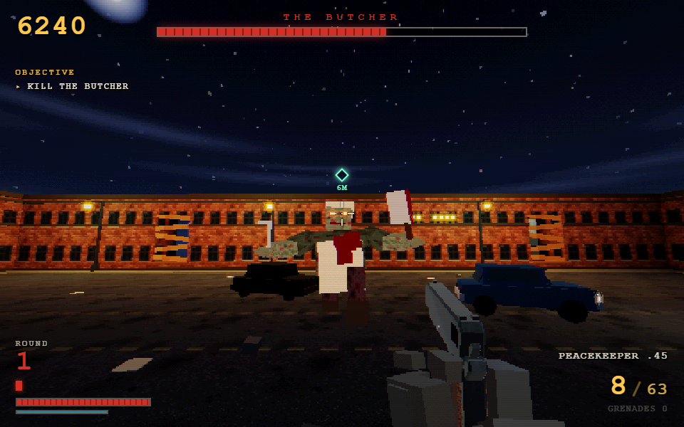
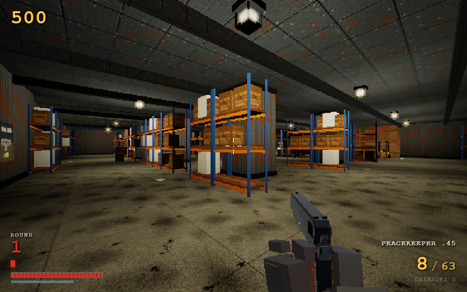
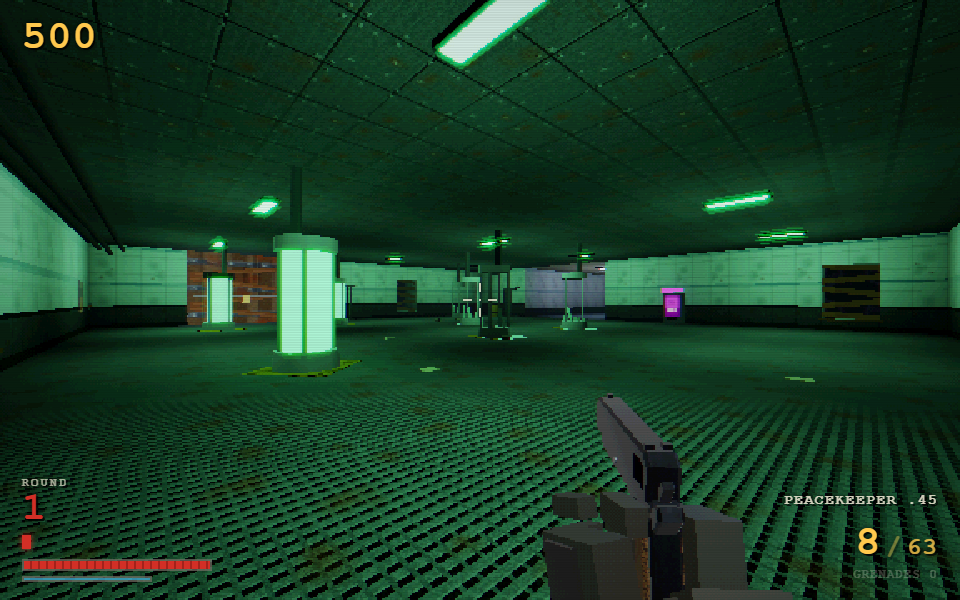
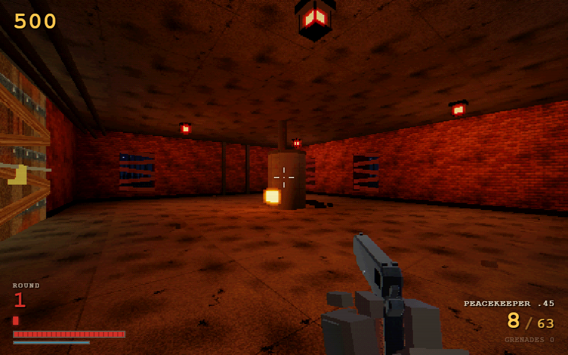

# RETRO ZOMBIE ARENA

An arcade wave-survival FPS that runs in the browser, dressed in the graphics of
the late-90s / early-2000s: a low-resolution HDR framebuffer (360p by default)
point-sampled up to the window, a filmic tone curve, bloom, ordered dithering,
scanlines, chunky nearest-neighbour textures, baked vertex lighting with light
pools and ambient occlusion, and low-poly monsters with glowing eyes.

It borrows its structure from *Call of Duty: Zombies* — points for hits and
kills, doors you buy your way through, wall guns, mystery boxes that roll for a
random (sometimes legendary) gun, perk machines behind a generator, a
Pack-a-Punch you can go back to three times, power-up drops, boardable windows
and an endless round curve — and its feel from *Doom*: no reload-to-cover, no
regenerating cover system, just strafing backwards through a crowd with a
shotgun while the walls close in.

It also has somewhere to go. Four chapters on four maps tell one story over the
radio, each with a job to do, a boss at the end of it and a way out; escape one
and the next unlocks. Or ignore the story and just survive: the rounds never
stop coming.

**Everything is generated at runtime.** There are no images, models, fonts or
audio files in this repository. Textures are painted onto canvases, the guns are
modelled in code from the dimensions of the real firearms they stand in for,
lighting is baked into vertex colours at load, and every sound - down to the
zombies' groans - is synthesised with the Web Audio API.

| Chapter | Map | The job | The boss |
| --- | --- | --- | --- |
| 1 · Admission | **St. Mercy Asylum** — wards, chapel, catacombs, morgue | build Voss a signal booster | The Warden |
| 2 · Outbreak | **Hollow Creek** — open streets under the night sky, the square, the churchyard, houses, the corner shop | light an evac flare | The Butcher (and his dogs) |
| 3 · The Furnace | **Vireo Ironworks** — loading bays, the casting floor, warehouses, the container yard | blow the sealed lift shaft | The Furnace Man |
| 4 · Patient Zero | **Vireo Labs: Sublevel 9** — labs, specimen tanks, server halls, the cryo vault, the reactor | build the purge | Patient Zero |

Every map is regenerated from a fresh seed every time you play it.

| | |
|---|---|
|  |  |
|  |  |
|  |  |
|  |  |
|  |  |

*(Screenshots are captured by `tools/diag.mjs` in headless Chromium with
software WebGL, so they are exactly what the game draws.)*

## Running it

Requires Node 20+ (developed on Node 24).

```bash
npm install
npm run dev        # http://127.0.0.1:5173
```

For a production build:

```bash
npm run build      # type-checks, then bundles to dist/
npm run preview    # serves dist/ at http://127.0.0.1:4173
```

`dist/` is a plain static site with relative asset paths, so it can be dropped
onto GitHub Pages, Netlify, S3 or any static host as-is. It will **not** run
from a `file://` URL — ES modules need a real HTTP origin. Use `npm run preview`
or any static server.

A WebGL-capable browser is required. The game is mouse-and-keyboard only and
uses Pointer Lock, so it needs a desktop browser.

## Controls

| Key | Action |
| --- | --- |
| `W` `A` `S` `D` | Move |
| Mouse | Look |
| Left mouse | Fire |
| Right mouse | Aim down sights |
| `Shift` | Sprint (drains stamina) |
| `Space` | Jump |
| `R` | Reload |
| `F` / `E` | Buy, use, or **hold** to re-board a window |
| `V` | Knife |
| `G` | Grenade (once you have bought some) |
| `1` `2` / `Q` / mouse wheel | Swap weapon |
| `Tab` | Map (centred on you) |
| `M` | Mute |
| `Esc` | Pause (settings are in the pause menu; `Esc` backs out) |

## The story

Vireo Pharmaceuticals made Compound L — "Lazarus" — to stop people dying. They
trialled it on the patients of St. Mercy Asylum. It worked, in its way. You wake
up in St. Mercy with three weeks missing from your memory, and a man calling
himself Dr. Voss starts talking to you over the radio. He helped make the stuff,
and he is going to talk you out: through the asylum, the town downstream that
drank its water, the ironworks that was never really an ironworks, and down nine
levels to where the first patient is still waiting.

**PLAY** opens the chapter select. Only the asylum is open at first; a chapter
unlocks when you **escape** the one before it — or survive to **round 15**
there, for players who would rather just hold out. Each chapter has a briefing,
and every run on it follows the same shape:

1. **Restore the power** — the generator (or the reactor) is always as far from
   the start as the map allows.
2. **Find three parts**, each in a different room somewhere out in the map.
   They sit on crates under a shaft of light.
3. **Build the device** at the workbench. It needs the power on.
4. **Survive the boss** it brings. Fourteen seconds later something comes in
   through a window: a health bar across the top of the screen, a name, and a
   set of moves it telegraphs before it uses them.
5. **Escape** through the sealed door in the start room, which opens once the
   boss is dead. That ends the run as a win.

An objective list sits under your points, a marker points at whatever comes next
(pinned to the edge of the screen when it is behind you), and Voss narrates in
subtitles. Your best round and fastest escape on each map are saved to
`localStorage`.

**The bosses.** Each is built on the zombie rig at nearly twice the size, scales
its health with the round it arrives in, and ignores the nuke and insta-kill.

- **The Warden** slams the floor (jump to clear the shockwave) and charges;
  a charge that hits a wall leaves him **stunned** and taking extra damage.
- **The Butcher** leaps across the room onto you and calls his hellhounds when
  he is hurt.
- **The Furnace Man** throws fireballs that leave the floor burning, cannot be
  set on fire, and starts charging once he is below half health.
- **Patient Zero** spits acid, leaps, slams, calls in runners twice, and in his
  last third he charges, moves faster and winds up quicker.

## How a run works

Each run builds a new layout of the chosen map from a random seed (shown when the
run starts). You wake up in one of its entry rooms with a pistol, 500 points, a
few boarded windows, a shotgun and a submachine gun on the walls, and Quick
Revive in the corner. The maps are big — up to fifteen rooms, many of them
merged great halls, open-air streets and yards, on a footprint of up to 94
tiles square where the original asylum was 56 — so the minimap (`Tab`) follows
you rather than showing the whole thing.

- **Points.** 10 per hit, 60 per kill, 100 for a headshot kill, 130 for a knife
  kill, 10 per board you nail back on, plus a survival bonus at the end of each
  round. (That end-of-round bonus is the one thing the source material does not
  do — it is there to keep the arcade pacing moving.)
- **Doors** cost 750–1500, dearer the deeper they lead. Rooms are joined in at
  least one loop, so there is always somewhere to train a horde; on the open
  maps many rooms share a wide archway instead of a door. Zombies only spawn
  from windows in rooms you have opened, favouring the ones near you, so every
  door you buy is also a decision about where they come from.
- **Wall guns** are bought once at full price, then refilled at half.
- **The mystery box** costs 950. The lid opens, guns flick past and slow down,
  and one rises out glowing the colour of its rarity: **common** (45%),
  **rare** (32%), **epic** (18%) or **legendary** (5%) — the Stormcaller
  (chain lightning), Winter's Howl (freezes what it hits) or Dragonfire (a
  flamethrower). Take it within nine seconds. After four to nine pulls a teddy
  bear comes up instead, refunds you and the box flies off to another pad. The
  bigger maps run two boxes at once.
- **The generator** is always the room farthest from where you start. Until you
  flip it, the perk machines and Pack-a-Punch are dead metal.
- **Perks** (max four): Quick Revive, Juggernog, Speed Cola, Double Tap,
  Stamin-Up. Only Quick Revive works without power.
- **Pack-a-Punch** works three times on the same gun: tier I (5000), II (7500)
  and III (10000) take its damage to ×2.4, ×3.6 and ×5, grow the magazine and
  reserve, and each paint it in a new glowing camo. Tier II also rolls an
  **ammo mod** — Dead Wire (lightning arcs), Blast Furnace (sets the crowd
  alight) or Cryofreeze (freezes a knot of them) — which tier III fires more
  often.
- **Power-ups** drop from kills: Max Ammo, Insta-Kill, Double Points, Nuke,
  Carpenter.
- **Every fifth round** is a hellhound round: fewer enemies, much faster, and the
  round always ends in max ammo.

Enemy health is flat-ish for nine rounds (150 → 950), then compounds at 10% per
round, so eventually nothing you own will kill in one magazine. Runners appear
from round 4, brutes from round 8. While a boss is alive the rest of the horde
thins out, so the fight is about the boss.

## Graphics settings

Four presets in the settings menu, from **1996** (200p, heavy dither) through
**1999** (240p) and **2003** (360p, the default) to **MODERN** (540p, almost no
post-processing). The 3D scene always renders into a small offscreen buffer and
is point-sampled up to the window, so the pixels stay square no matter how large
your monitor is. **Brightness**, FOV, sensitivity, Y-invert and volume are also
adjustable and persist.

## Project layout

```
src/
  main.ts              boot, menus, settings, frame loop
  style.css            HUD and menu styling (CRT treatment)
  core/
    retro.ts           HDR render target + tone curve, bloom, dither, scanlines
    input.ts           keyboard + mouse + pointer lock
    audio.ts           procedural Web Audio: guns, zombie voices, reload foley, reverb
    rng.ts             seeded mulberry32
  gfx/
    textures.ts        every texture, painted onto a canvas at 32–128px
    guns.ts            weapons modelled from real firearms, hands, forearms, camos
    models.ts          zombie/hound models, mesh merging, particle field
    bosses.ts          the four bosses, dressed on the zombie rig
  world/
    maps.ts            the four map profiles: size, openness, kinds of room
    mapdata.ts         the layout generator and the rules every layout must pass
    grid.ts            circle/tile collision, DDA raycasting, BFS flow field
    themes.ts          what each kind of room (and passage) looks like
    lighting.ts        shadowed light bake, moonlight, light probe
    batch.ts           merges static geometry per material and bakes it
    build.ts           walls, floors, windows, lamps and street lamps
    sky.ts             the night sky over the open-air maps
    furnish.ts         helpers and furniture shared by all set dressing
    dressing.ts        the asylum's rooms, and the dresser for every theme
    dress-town.ts      streets, square, churchyard, houses, shop, garage
    dress-works.ts     loading bays, casting floor, warehouses, container yard
    dress-labs.ts      labs, specimen tanks, servers, cryo, reactor
    props.ts           doors, windows, perk machines, box, Pack-a-Punch
    questprops.ts      the parts, the workbench and the exit
  game/
    rules.ts           round curve, scoring, perks, power-ups (pure)
    weapons.ts         weapons, rarities, Pack-a-Punch tiers, ammo mods (pure)
    player.ts          movement, health, wallet, two-slot inventory (pure)
    enemy.ts           enemy state machine, animation, pooling
    boss.ts            boss moves on top of the enemy state machine
    box.ts             the mystery boxes
    elements.ts        lightning bolts, ice and fire effects
    story.ts           the four chapters: briefings, parts, bosses, radio lines
    quest.ts           power -> parts -> build -> boss -> escape (pure)
    progress.ts        unlocks and per-map records (pure rules, localStorage)
    viewmodel.ts       first-person weapon, hands and reload choreography
    hud.ts             DOM HUD: objectives, radio, boss bar, marker, minimap
    game.ts            the loop that ties it together
test/
  logic.test.ts        48 unit tests over the pure half of the game
  browser-smoke.mjs    142 checks driving the real game in headless Chromium
tools/
  mapcheck.mjs         prints a generated layout as ASCII, or sweeps many seeds
  diag.mjs             screenshots every room of a seed, the horde and a reload
  story.mjs            screenshots the menus, quest props and every boss
  guns.mjs             contact sheets of every weapon: hip, sights, reload
  deaths.mjs           contact sheet of hit reactions and every kind of death
  pursuit.mjs          times how fast a scattered horde finds the player
docs/                  the screenshots above
```

## How it is put together

A few decisions are worth calling out, because they are what make the look and
the horde possible at the same time:

**Every run is a new layout.** `mapdata.ts` drops rooms into a coarse grid of
cells (up to 4×4 with a few knocked out), merges some neighbours into great
halls, joins the rest with passages along a random spanning tree plus extra
links for loops — some of them wide open archways — themes the rooms, and then
places windows, wall guns, perks, box pads, the power switch, Pack-a-Punch, the
three quest parts, the workbench and the exit against real walls. How big, how
open and what kind of rooms is a per-map profile in `maps.ts`. `validateLayout`
checks every rule the old hand-built map had to pass — props on floor with wall
behind, doors with floor on both faces, the start room sealed until a door is
bought, everything reachable once they all are, clear ground outside every
window, the parts in three different rooms away from the start — and a seed
that fails is re-rolled. `npm run map -- --map=town --sweep 1000` generates a
thousand of them.

**Some of it is outdoors.** Streets, the square, the churchyard, the container
yard and the alleys between them have no ceiling. The walls become building
fronts with a string course and a cornice against the sky; lamps become
cast-iron street lamps standing along the walls and out across the squares;
the bake adds a cold moonlight from the moon's direction to everything open to
the sky; the fog opens right out when you step outside; and a painted night
sky — stars, a band of galaxy, low cloud lit from below, a moon big enough to
bloom — rides along with the camera, drawn first with no depth so the whole
level covers it. Down in Sublevel 9 the windows look into ventilation shafts
instead.

**The level is a handful of meshes, lit once.** `build.ts` walks the tile map
and emits walls in bands - skirting, wainscot, dado rail, upper wall - plus
floors, ceilings, window reveals and lamp fixtures; `dressing.ts` adds each
room's furniture. All of it goes through one batcher that merges it per material
and runs a CPU lighting pass: lamps with a smooth falloff, shadows from a 2D ray
march over the tile grid (so light pools stay in their room and spill only
through doors and windows), baked ambient occlusion in corners and along the
floor, and low-frequency grime to break up texture repetition. At runtime the
scene ambient is set to exactly `π`, which cancels three.js's Lambert `1/π`
term, so a baked colour of 1.0 renders at its full texture value. A per-tile
probe of the same light tints everything that moves, so a zombie under a lamp is
bright and one in the furnace glows orange.

**The picture is colour-correct.** The scene renders linear light into a
half-float buffer; the final pass applies exposure (the brightness slider), a
filmic curve and the sRGB encode *before* it quantises and dithers, so the
colour steps land where the eye can see them. Anything brighter than white -
lamp tubes, zombie eyes, muzzle flashes - blooms.

**Pathing is a flow field, not per-enemy A\*.** A breadth-first search from the
player's tile is rebuilt about seven times a second over up to ~9000 cells,
and every zombie reads it. Each one thinks a few times a second: with the player in plain
sight - checked with a ray down the middle and one along each shoulder, so it
never tries to squeeze round a corner it cannot fit past - it walks straight at
them; otherwise it follows the field a few tiles ahead and heads for the
farthest point it can reach in a straight line, so paths cut corners smoothly.
A body that stops making progress steps to the best neighbouring tile, and one
that has been far away, out of sight and getting no closer for six seconds is
recycled through a window nearer the player, so the horde never loses the
scent. Out of sight and far away, they also hurry — up to twice their speed
across the far side of a big map. `tools/pursuit.mjs --map=town` scatters
zombies over a fully opened map and times how long they take to find you.

**The story is a small state machine.** `quest.ts` knows only power, three
parts, built, the boss's state and escaped; every transition returns the story
beats it produced, and the game turns those into radio subtitles, banners,
sounds and the objective marker. Because it is pure, the whole chain is unit
tested. **Bosses** are `Enemy` subclasses: they hunt with the same flow field,
but between thinks they pick a move whose cooldown is ready and whose range
fits — a slam up close, a charge or a leap at range, a lob at anything in
sight — stand still for a wind-up pose, then do it. The boss only decides; the
game supplies the consequences through a small hooks interface (shockwaves,
knockback, fireballs and burning ground, summons), so none of it knows about
particles or sound.

**Hits and deaths have weight.** A hit rocks the body away from the shot on a
spring, snaps the head back on a headshot, staggers it for a moment and shoves
it back. A kill picks a death - thrown on its back, pitched onto its face,
buckling at the knees and keeling over, or launched and tumbling by an
explosion - and a headshot kill takes the head clean off. Bodies stay down for a
couple of seconds before they sink through the floor. `tools/deaths.mjs`
renders a contact sheet of all of it.

**The guns are modelled, not imported.** `guns.ts` builds each weapon in
metres from its real-world reference - M1911, Thompson M1928 with the drum, M3
Grease Gun, AK-47, scoped Lee-Enfield No.4, SPAS-12, a sawed-off coach gun, an
M9 bazooka - out of extruded side profiles, cylinders and boxes, with named
anchors for the hands, magazine, bolt, pump and muzzle. The first-person weapon
renders in its own scene after a depth clear (the standard trick for keeping a
long barrel out of walls), with reflections from a generated environment map.
Aiming down the sights is computed from each gun's actual sight line.

**Reloads are choreographed.** The right hand is fixed to the grip; the left is
driven by keyframed timelines per reload style: pull the magazine, fetch a new
one, seat it, rack the charging handle; drop a pistol mag and release the slide;
break the shotgun and thumb in two shells; feed a pump gun one shell at a time;
work a bolt and push down a stripper clip. Timelines are normalised to the real
reload time, so Speed Cola speeds up the whole performance, and every step cues
its own synthesised foley.

**The dead have voices.** Each groan is a sawtooth glottal source with a sagging
pitch contour and a vocal-fry rattle, soft-clipped, then passed through three
formant filters that glide between vowels ("oooaaahhh") and into a generated
reverb. Walkers moan, hunters growl, attackers snarl, runners scream and the
dying gurgle; brutes are pitched down. A voice limiter keeps a full horde from
turning into mush.

**Nothing allocates in the hot path.** Enemies, tracers, decals, particles,
casings and power-up drops are all pooled and built once in the constructor.
Each zombie's static boxes are merged per joint, so a body costs under twenty
draw calls however much detail it carries.

## Verification

```bash
npm run typecheck     # tsc --noEmit, strict, erasableSyntaxOnly
npm test              # 48 unit tests (node:test, runs .ts directly)
npm run map           # prints a random asylum and validates it
npm run map -- --map=labs --sweep 1000   # generates and validates a thousand seeds
npm run build         # type-check + bundle
npm run test:browser  # builds, then runs 142 checks in real headless Chromium
```

`npm test` covers the pure half: that 300 generated asylums, and sixty of
every other map, each pass every layout rule (sealed until a door is bought, fully connected after, every window,
wall gun, perk machine and pad on legal geometry, clear ground outside every
window), that a seed always rebuilds the same asylum and different seeds do
not, that door prices climb with depth, that collision ejects a body out of a
wall rather than through it, that the flow field strictly descends to its goal
from every reachable tile, that every weapon has a model, that the round
curve never gets easier, that the box's rarity odds hold, that each
Pack-a-Punch tier hits harder, that the quest only runs in order (no building
without power, no escaping with the boss alive), that escaping or reaching
round 15 unlocks the next map and nothing else, that every chapter has a
boss and something to say at every beat, and that bosses get tougher chapter
by chapter and round by round.

`npm run test:browser` is the one that matters for "does it actually work". It
builds, serves `dist/`, opens it in headless Chromium with software WebGL, and
drives the real game object. It reads the low-resolution framebuffer back and
asserts the world rasterised with a real tonal range; runs 45 seconds of round 1
and checks that enemies spawn, tear boards off windows, get inside and hurt an
idle player; buys a door and confirms the tile became walkable; buys a wall gun,
a perk, Pack-a-Punch and a mystery box pull; applies power-ups; holds the
trigger down on a line of zombies and checks that ammo drains, points accrue,
headshots register, reloads refill, an empty gun stays empty, a wall stops a
bullet and the same burst lands in the open; clears a round and checks the
counter advanced; pauses and resumes; kills the player and checks the run
reports stats; starts six runs and checks each got a different asylum, that a
seed replays and that rebuilding the world does not leak GPU memory; reloads
every weapon from empty and checks the animation finishes, refills the gun and
cues its foley; aims the scoped rifle; opens settings from the pause menu,
changes one live and backs out with Esc; scatters a dozen zombies over an open
asylum and checks every one finds the player; checks a hit rocks and shoves a
body and a kill drops it, leaves it on the floor, then cleans it up; sounds
every kind of zombie voice through a real AudioContext and floods the voice
limiter; builds all four maps and checks their boxes and sky; plays the whole
story on the asylum — objectives, marker and radio, power, the three parts,
the build, the boss arriving through a window with its health bar, surviving
a nuke, dying, the exit opening, the victory screen and the next chapter
unlocking; sets each of the four bosses on an idle player and checks it
arrives, uses its moves and hurts; and walks the chapter select, a locked
chapter and a briefing — then asserts no console or page errors throughout.

It needs Chromium once: `npx playwright install chromium`.

`tools/diag.mjs [seed] [--map=town]` writes screenshots to `tools/shots/<map>/`
- one per room of that seed's layout, a window, the horde, hounds and a
reload - along with brightness statistics of the finished frame.
`tools/story.mjs` shoots the chapter select, a briefing, the quest props and
each boss up close. It is how the lighting was tuned,
and it is the fastest way to see whether a rendering change made things better
or worse. `tools/guns.mjs [weapon...]` renders a contact sheet per weapon: hip,
aiming down the sights, and four moments of its reload.

## Assumptions made

This was built from a one-line brief, so a few things were decided rather than
asked:

- **Web / TypeScript / three.js**, because "runs anywhere by opening a link" is
  worth more for a game like this than native performance, and because it makes
  the whole thing verifiable headlessly.
- **Single player only.** Co-op is the other half of the source material, but it
  needs netcode, and the brief said arcade.
- **The story is original.** Vireo, Compound L, Dr. Voss and the four bosses are
  made up for this game; the structure (build something, fight what it
  summons, get out) is the genre's.
- **Escaping ends the run.** It is a win screen with your stats rather than an
  option to carry on; the endless mode is simply not escaping.
- **Unlocks have a second door.** Surviving to round 15 on a map also opens the
  next one, so a player who never wants to do the objective is not locked out.
- **Downs are final.** There is no bleed-out-and-self-revive; a down ends the
  run. Quick Revive instead speeds up health regeneration.
- **A survival bonus at the end of each round**, which the source material does
  not have, to keep early rounds from dragging.
- **Room dressing has no collision.** Pews, desks, crates and the boiler are
  there to give each room a silhouette; you and the horde walk through them.
  Solid clutter would need per-prop collision and would turn the arena into a
  snag-fest, which is the opposite of arcade.
- **No gore beyond blood particles and decals** — bodies crumple and sink rather
  than dismembering, other than the gib-on-overkill case.
- **Weapons are modelled from references, not downloaded.** Third-party gun
  models come with licences and attribution strings, and this project ships no
  asset files, so each gun is built in code from the published dimensions and
  silhouette of the real firearm. The two wonder weapons are homages, not copies.
- **Old settings move to the new renderer.** Settings saved before the
  colour-correct renderer keep sensitivity, volume, FOV and Y-invert, but start
  on the new default graphics preset, since the old default was tuned for a
  picture that was far too dark.

## Licence

No licence chosen; the brief did not specify one. All assets are generated by
the code in this repository, so there is nothing third-party to attribute beyond
[three.js](https://threejs.org/) (MIT).
